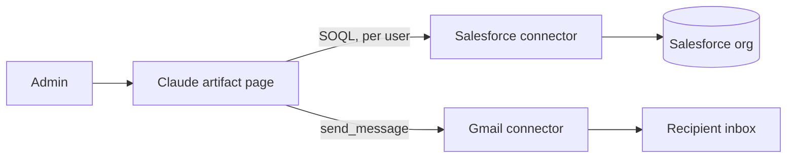

# Salesforce Wrapped Builder

A year-in-review builder for Salesforce, in the style of Spotify Wrapped. An admin chooses what goes into the recap, previews it for any user, then emails each person their own recap. Each recap uses only that person's records.

It is a single HTML page (`index.html`) that runs as a **Claude artifact**. It reads Salesforce and sends email through the viewer's own claude.ai connectors, so there is no server and no credentials to manage.

## Try it

**Sample-data demo (no sign-in):** https://jtsanchez.github.io/salesforce-wrapped-builder/

The demo runs on made-up data so you can look around: set up numbers, switch themes and preview a story and email. Connecting a real org and sending email only work when the page runs as a Claude artifact (see [Set up your own copy](#set-up-your-own-copy)). On the hosted demo, the Connection tab says connectors are not available. That is expected.

## Demo video

(https://www.loom.com/share/88ca2b0e6b49479c8a9bb4d4d84a9487)

> Demo project. The sample data is made up.

## What each person gets

A five-slide story and a matching email:

1. **Intro**: "Your Salesforce recap" with the person's first name and the year.
2. **Your numbers**: up to four numbers, shown as a count, a percentage, or a sum (for example, a currency total).
3. **Busiest month**: a 12-month chart and a caption such as "12 deals in March".
4. **Fun highlight**: for example, the contact the person worked with most. Tasks and events can be counted together or separately.
5. **Your year in one word**: a word and emoji picked by rules the admin writes, for example "Finisher" when 100 tasks are completed.

The year is always the current year.

## What the admin controls

| Tab | What you do |
|---|---|
| Read me | A short guide with a sample story and sample email |
| Connection | Connect a Salesforce org, or stay on sample data. Includes first-time help for adding the connector |
| Setup | Numbers, busiest month, fun highlight, one-word rules, email message, and save or share your setup |
| Theme and Preview | Pick a theme, add pictures to the first and last slides, and preview the story and email for any user |
| Send | Send a test to yourself, choose recipients, then send |

### Setup

- **Numbers**: choose an object, the user field, the date field and filters. Show it as a count of records, a percentage of records, or a sum of a field.
- **Busiest month**: choose what to count by month, with the same field and filter options.
- **Fun highlight**: a title, the records to count (tasks and events together, tasks only, events only, or another object), the user field, and filters.
- **Your year in one word**: rules such as "if tasks completed is 100%, use this word", plus a fallback and an emoji for each word.
- **Email message**: your own text under the greeting and at the bottom of the email.
- Fields with a problem are marked in red on the Setup tab with a short reason.

### Themes

Classic, Christmas, Superheroes, Salesforce, **Company brand** (upload an image and pick slide colours from it) and Custom. The presets use original styling only, with no logos or characters. You can also add a picture to the first and last slides.

### Sending

- Emails go from the admin's own Gmail, one at a time, to each person's email address in Salesforce.
- The subject is always "{first}, your Salesforce {year} in review".
- Send a test to yourself first. The Send button stays off until a test has gone out.
- Choose recipients with filters on User fields (for example, Department), up to 200 users.
- Each email can include that person's story as an HTML file. The person must download it and open it in a web browser to view it.

## How it fits together



- The page calls the viewer's own connectors: **Salesforce SObject All** (`soqlQuery`, `getObjectSchema`, `getUserInfo`) and **Gmail** (`send_message`). The page never sees tokens.
- SOQL is built from the admin's choices. Object and field names are validated, filter values are escaped, and only whitelisted operators are allowed.
- Each person's numbers come from queries filtered to that user, so a recap only contains their own records.
- Setup is kept in the browser. It can be exported and imported as JSON.

## Set up your own copy

You need a Claude account with connectors enabled, and a Salesforce org you can connect (a free [Developer Edition org](https://developer.salesforce.com/signup) works).

1. Download [`index.html`](index.html).
2. In a new Claude chat, attach the file and say: *"Publish this as an artifact, and let it use my Salesforce SObject All and Gmail connectors."*
3. In claude.ai, add a Salesforce connector named exactly **Salesforce SObject All**, and a Gmail connector. The page's **Connection** tab has step-by-step help.
4. Open your artifact, go to **Connection**, and connect your org.
5. Set up your numbers on **Setup**, check them on **Theme and Preview**, send a test on **Send**.

Without a Salesforce connector, choose **Use sample data** to try everything except real records.

### Connector URL

For a Developer Edition or other production org, the Salesforce MCP server URL is:

```
https://api.salesforce.com/platform/mcp/v1/platform/sobject-all
```

Sandbox and scratch orgs use `https://api.salesforce.com/platform/mcp/v1/sandbox/platform/sobject-all`. The server must be activated in Setup under MCP Servers, and you need an External Client App with the `mcp_api` and `refresh_token` scopes. Follow [Salesforce's guide for Claude](https://developer.salesforce.com/docs/platform/hosted-mcp-servers/guide/claude.html).

### Sharing

- Share with people **in the same claude.ai organization** and each of them can connect their own org.
- People outside that organization can open a shared link but get no connector access. The page then says "Connectors are not available in this view", and only sample data works.
- To give outside people their own working copy, send them `index.html` and the steps above. Each copy is separate, so updates to this file don't reach it.

## Demo script

1. Open the page and read the **Read me** sample.
2. On **Connection**, connect an org. The header badge shows which org is in use.
3. On **Setup**, add "Deals won" (Opportunity, Closed Won, count) and "Tasks completed" (Task, percentage).
4. Add a rule: if tasks completed is 100%, the word is "Finisher".
5. On **Theme and Preview**, switch themes and pick a person. The story and email update together.
6. On **Send**, send a test to yourself. Open the attached story file in a browser.

## Limitations

- Tested against sample data, mock Salesforce responses and a handful of queries against one connected org. It has not been run across several real orgs, and the Gmail sending path has not been tested at volume.
- Connecting an org and sending email only work in claude.ai, where the page can use connectors. Anywhere else (including the hosted demo) it falls back to sample data.
- Records are counted by the date field you choose, for the current year only.
- The fun highlight ranks by linked company, then linked contact, then the person on the record, using whichever has data. You can't choose this yet.
- Email apps block embedded pictures, so pictures on the first and last slide show in the story but not in the email.
- Some mail systems warn about or block attached HTML files. Always send yourself a test first.
- Only the first 200 matching users are loaded.
- Not checked with a screen reader or an automated accessibility tool. It uses labelled form controls and text status messages, but it makes no claim of WCAG conformance.
- Background music, a Lightning component version and a standalone web app with its own "Log in with Salesforce" button are not built.

## Ideas to extend it

- A standalone web app with Salesforce OAuth, so people outside a Claude organization can use it.
- Send through Salesforce instead of Gmail.
- A Lightning Web Component so users can view their recap inside Salesforce.
- Optional background music in the attached story file.
- A choice of which field the fun highlight ranks by.

## Built with

A single HTML page (plain JavaScript and CSS) published as a Claude artifact, with the Salesforce and Gmail connectors. I set the idea, the scope and the design decisions. Claude helped with the code, the SOQL building, the email layout and testing.

## Licence

MIT. See [LICENSE](LICENSE).
